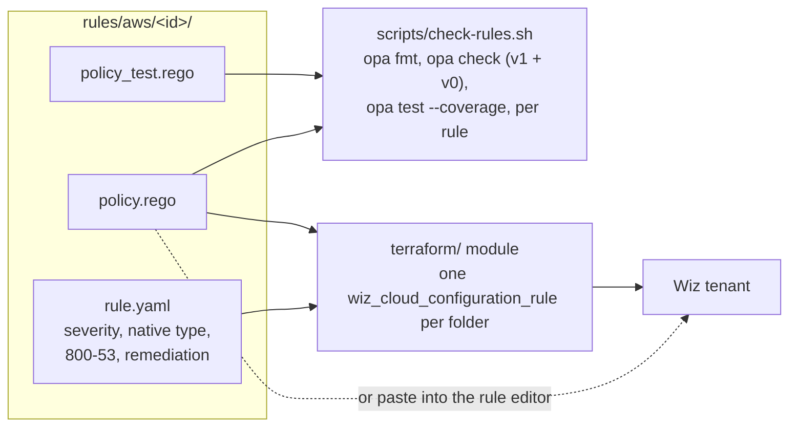

# wiz-cloud-config-rules

[](https://github.com/DustyStudy/wiz-cloud-config-rules/actions/workflows/ci.yml)
[](https://github.com/DustyStudy/wiz-cloud-config-rules/actions/workflows/security-scan.yml)
[](LICENSE)

Custom [Wiz](https://www.wiz.io/) Cloud Configuration Rules for AWS, written
in Rego and mapped to NIST SP 800-53. They encode an opinionated FedRAMP-style
baseline: customer managed keys, TLS-only buckets, no public SSH or RDP,
IMDSv2, tamper-evident CloudTrail and GitHub OIDC roles pinned to one
repository. Load them into a tenant by pasting a rule into the Wiz UI or with
the included Terraform module.

**At a glance**

- **Problem:** a custom rule that misreads its input does not error. A missing
  field compares as undefined in Rego, falls through to `pass`, and the rule
  quietly reports everything as compliant.
- **Approach:** every rule reads fields with explicit defaults, so missing data
  fails instead of passing, and every rule has a test with its key field
  absent. Policy documents are parsed whether Wiz hands them over as an
  object, a JSON string or a URL-encoded string. No rule hard-codes the
  `arn:aws:` partition, so the same rules work in GovCloud.
- **Result:** 133 `opa test` cases across nine rules, each rule at 96% line
  coverage or higher, checked in OPA v1 and v0-compatible modes. Five
  `terraform test` runs prove the module's wiring on Terraform 1.9.8 and
  1.16.4 with a mocked Wiz provider.

## How it fits together



## Rules

| Rule | Fails when | Severity | NIST SP 800-53 |
|---|---|---|---|
| [`kms-cmk-rotation`](rules/aws/kms-cmk-rotation) | An enabled, customer managed, symmetric key with KMS-generated material has rotation off, or rotates less often than every 365 days | HIGH | SC-12, SC-28 |
| [`s3-deny-insecure-transport`](rules/aws/s3-deny-insecure-transport) | No bucket policy statement denies `s3:*` for all principals on the bucket and its objects when `aws:SecureTransport` is false, or the policy is missing or unparseable | HIGH | SC-8, SC-8(1) |
| [`s3-default-encryption-cmk`](rules/aws/s3-default-encryption-cmk) | Default encryption is missing, SSE-S3, or SSE-KMS / DSSE-KMS with no key ID or the `aws/s3` key | MEDIUM | SC-28, SC-12 |
| [`s3-server-access-logging`](rules/aws/s3-server-access-logging) | Server access logging is off | MEDIUM | AU-2, AU-12 |
| [`s3-versioning-enabled`](rules/aws/s3-versioning-enabled) | Versioning was never enabled or is suspended | MEDIUM | CP-9 |
| [`sg-no-public-management-ports`](rules/aws/sg-no-public-management-ports) | Ingress from `0.0.0.0/0` or `::/0` reaches port 22 or 3389 over TCP or UDP, or allows all traffic | CRITICAL | SC-7, AC-17 |
| [`ec2-imdsv2-required`](rules/aws/ec2-imdsv2-required) | The metadata endpoint is on and `HttpTokens` is not `required` | HIGH | AC-3, CM-6 |
| [`cloudtrail-integrity`](rules/aws/cloudtrail-integrity) | A trail lacks log file validation, a KMS key, or multi-region coverage | HIGH | AU-9, AU-9(3), AU-12 |
| [`iam-github-oidc-trust-pinned`](rules/aws/iam-github-oidc-trust-pinned) | Any statement trusting `token.actions.githubusercontent.com` does not require `aud` = `sts.amazonaws.com` and a `sub` naming a concrete owner and repository | CRITICAL | AC-3, AC-6, IA-8 |

The control mappings show which 800-53 controls a rule provides evidence for.
A rule is partial evidence for a control, not a full implementation of it.

## Use the rules

### Paste into the Wiz UI

1. Create a custom Cloud Configuration Rule.
2. Paste the rule's `policy.rego`. Each file is self-contained.
3. Set the native type, severity, description and remediation from the rule's
   `rule.yaml`.

### Deploy with Terraform

```hcl
provider "wiz" {
  # Credentials come from WIZ_CLIENT_ID and WIZ_CLIENT_SECRET.
  # environment = "gov" # or "fedramp" for Wiz for Gov tenants
}

module "wiz_rules" {
  source = "git::https://github.com/DustyStudy/wiz-cloud-config-rules.git//terraform?ref=v0.1.0"

  # Pilot on a few accounts first, then remove to assess all accounts.
  # scope_account_ids = ["<wiz-cloud-account-id>"]
}
```

The module uses the official provider, `tf.app.wiz.io/wizsec/wiz` 1.28 or
later, and needs a Wiz service account with `create:cloud_configuration`,
`read:cloud_configuration`, `update:cloud_configuration` and
`delete:cloud_configuration`.

| Variable | Default | Purpose |
|---|---|---|
| `exclude_rules` | `[]` | Rule IDs to leave out |
| `scope_account_ids` | `null` (all) | Limit the rules to these Wiz cloud accounts |
| `function_as_control` | `false` | Also create Issues, not only Configuration Findings |
| `name_prefix` | `"Custom - "` | Tell these rules apart from built-ins |
| `native_type_overrides` | `{}` | Replace a rule's native types, keyed by rule ID |

Each rule gets three tags: `source = wiz-cloud-config-rules`, `rule_id`, and
`nist-800-53` with the rule's controls.

## Validation status

**Verified offline**

- `opa test` runs every pass, fail and skip case, including absent and null
  fields, mixed field casing, URL-encoded and malformed policy documents, and
  GovCloud ARNs.
- `opa check` passes in OPA v1 mode (`--strict`) and `--v0-compatible` mode,
  so the syntax works on older and newer OPA runtimes.
- `terraform test` with a mocked provider checks that every rule folder
  becomes a resource, that exclusions and overrides work, that the NIST tag is
  set, and that invalid overrides are rejected.
- The provider resource and arguments were taken from the official provider's
  published schema (1.28.19776).

**Confirm on first use in a tenant (about five minutes)**

1. In the rule editor, check the native type for each resource. The names in
   `rule.yaml` (`bucket`, `key`, `securityGroup`, `instance`, `trail`, `role`)
   follow public examples; put any correction in `native_type_overrides`.
2. Run each rule's built-in test against one real resource and compare field
   names. Rules accept AWS API PascalCase and lowerCamel keys.
3. Apply with `scope_account_ids` set to one account.
4. Review the findings before turning on `function_as_control`.

**Known limits**

- `s3-default-encryption-cmk` cannot tell a customer managed key from an AWS
  managed key by ID or ARN alone, so it flags only SSE-S3, a missing key ID
  and the `aws/s3` alias.
- `cloudtrail-integrity` checks configuration. It does not show that the
  trail is logging; use `aws cloudtrail get-trail-status` for that.
- Rules use common OPA built-ins (`json.unmarshal`, `urlquery.decode`,
  `object.get`, `array.concat` and string functions). The Wiz runtime's
  built-in support is confirmed in step 2.

## Add a rule

1. Create `rules/aws/<id>/` with `policy.rego`, `policy_test.rego` and
   `rule.yaml` (`id` must match the folder name).
2. Start `policy.rego` with `package wiz`, `default result := "pass"`, and a
   `result` chain that returns `skip` for out-of-scope resources and `fail`
   for violations. Set `currentConfiguration` when failing and
   `expectedConfiguration`. Copy the `field` and `fieldd` helpers from an
   existing rule; rules do not share code, so each file can be pasted alone.
3. Write tests first, including one with the key field absent.
4. Run `./scripts/check-rules.sh` and `terraform -chdir=terraform test`.

The Terraform module picks up the new folder automatically.

## License

[MIT](LICENSE)
